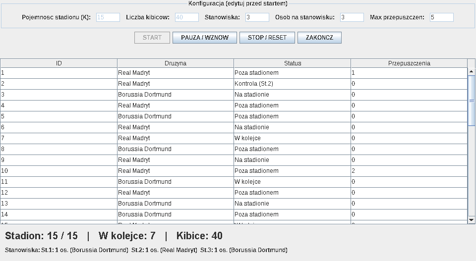

# Stadion — symulacja wejścia kibiców na mecz

Projekt na programowanie współbieżne (zadanie PW-18). Symulacja wejścia kibiców na finał Ligi
Mistrzów: każdy kibic to osobny wątek, który przychodzi pod stadion, staje w kolejce, przechodzi
kontrolę na jednym z trzech stanowisk, a potem siedzi na trybunach. Na stadionie może przebywać
jednocześnie maksymalnie K osób.



## Uruchomienie

Potrzebne jest JDK 11 lub nowsze (testowane na JDK 27). Wszystkie komendy z katalogu głównego projektu.

```bash
javac -encoding UTF-8 -d out src/stadion/*.java
java -cp out stadion.StadionGUI
```

Program czyta i zapisuje `resources/config.properties`, więc uruchamiaj go z katalogu głównego.
Flaga `-encoding UTF-8` jest potrzebna, bo w okienku są polskie znaki.

## Parametry

| Klucz | Znaczenie | Domyślnie |
| --- | --- | --- |
| `K` | maksymalna liczba osób na stadionie | 15 |
| `LiczbaKibicow` | ile wątków-kibiców startuje | 40 |
| `LiczbaStanowisk` | liczba stanowisk kontroli | 3 |
| `MaxOsobNaStanowisku` | ile osób mieści jedno stanowisko | 3 |
| `MaxPrzepuszczen` | ile osób kibic może przepuścić w kolejce | 5 |

`K` i `LiczbaKibicow` zmieniasz w oknie, przed kliknięciem START — po starcie są zapisywane z powrotem
do pliku, więc następne uruchomienie zaczyna z tymi samymi wartościami. Trzy pozostałe parametry są
ustalone w treści zadania i pokazane w oknie tylko do wglądu; zmienia się je w pliku (wczytywane raz,
przy starcie programu).

## Życie kibica

1. Przychodzi — startuje z losowym opóźnieniem do 5 s, żeby nie wszyscy pojawili się naraz.
2. Kolejka — zgłasza się do monitora i czeka, aż będzie miejsce na stadionie i na wolnym stanowisku.
3. Kontrola — spędza na stanowisku 1,5–3,5 s.
4. Stadion — zwalnia stanowisko i siedzi na trybunach 4–10 s. Cały ten czas zajmuje jedno z K miejsc.
5. Wyjście — zwalnia miejsce i kończy wątek.

Drużyna (Real Madryt albo Borussia Dortmund) jest losowana przy starcie kibica.

## Synchronizacja

Cały stan monitora jest chroniony jednym `ReentrantLock`em w trybie sprawiedliwym. Na zamku wiszą
trzy warunki:

| Warunek | Kto czeka | Kto budzi |
| --- | --- | --- |
| `wejscieNaStadion` | kibic, gdy na stadionie jest już K osób | kibic wychodzący ze stadionu |
| `stanowiskoDostepne` | kibic, gdy nie ma dla niego wolnego stanowiska | zwolnienie stanowiska i wyjście ze stadionu |
| `pauseCondition` | wszystkie wątki po kliknięciu PAUZY | wyłączenie pauzy albo STOP |

`safeSleep()` śpi porcjami po 100 ms i przy każdej porcji sprawdza stan monitora, dzięki czemu pauza
i STOP działają od razu, także w trakcie kontroli i meczu. STOP ustawia flagę, budzi wszystkie warunki
i przerywa wątki; kolejny START tworzy nowy monitor i nowy zestaw kibiców.

## Zasady z zadania i ich realizacja

| Zasada | Realizacja |
| --- | --- |
| maksymalnie K osób na stadionie | licznik `obecniNaStadionie`, zwiększany przy wejściu, zmniejszany przy wyjściu |
| kontrola na 3 stanowiskach | lista `stanowiska` o rozmiarze `LiczbaStanowisk` |
| maksymalnie 3 osoby na stanowisku | `mozeWejscNaStanowisko()` sprawdza rozmiar listy osób |
| na stanowisku tylko jedna drużyna | stanowisko należy do drużyny pierwszego kibica, dopóki jest zajęte |
| kibic przepuszcza maksymalnie 5 osób | licznik `liczbaPrzepuszczen` i blokada wejścia, gdy ktoś czekający ma już 5 |

Ostatni punkt działa tak: gdy kibic wchodzi na stanowisko, wszystkim stojącym przed nim w kolejce
zwiększa się licznik przepuszczeń, bo to oni zostali wyprzedzeni. Kibic z licznikiem równym 5 blokuje
wejście pozostałym, więc wchodzi jako następny. Gwarantuje to sprawiedliwy zamek razem z `signalAll()`,
a nie osobna kolejka FIFO — kolejność jest więc odtworzona w przybliżeniu, a nie co do jednego miejsca.

## Pliki

```
src/stadion/Kibic.java           wątek kibica
src/stadion/StadionMonitor.java  stan współdzielony i synchronizacja
src/stadion/StadionGUI.java      okno Swing, tabele i podgląd stanowisk
resources/config.properties      parametry symulacji
docs/zrzut-ekranu.png            zrzut działającego programu
```

## Uwagi

- STOP przerywa wątki w połowie pracy, więc licznik osób na stadionie nie schodzi do zera; nie ma to
  znaczenia, bo następny START zaczyna od nowego monitora.
- Plik z parametrami jest nadpisywany przez `Properties.store()`, więc własne komentarze w nim przepadają.

